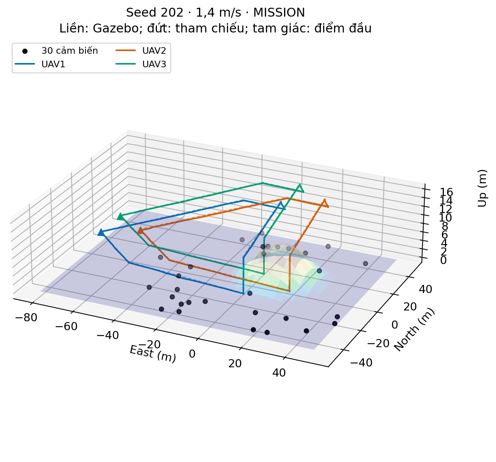

# UAV Farm Coverage

Three-UAV formation planning and sensor-service coverage on a synthetic hilly farm, using **ROS 2 Jazzy, PX4 SITL and Gazebo**, with optional **offline ns-3.43 replay**.

[Tiếng Việt](README.vi.md) · [Installation](docs/INSTALL.md) · [Architecture](docs/ARCHITECTURE.md) · [Results and limitations](docs/RESULTS.md) · [Source provenance](docs/PROVENANCE.md)



## What is included

- Shared planner, motion profiles, ROS 2 Offboard controller, telemetry checks and LiDAR fleet guard.
- Five retained 30-sensor layouts: **101, 202, 303, 404, 505**, with supplied 1.4 m/s nominal reference plans.
- A triangular virtual structure, shared progress, terrain clearance and pair-distance constraints.
- Recorded Gazebo traces and service windows for standalone network replay.
- Fifteen historical speed cases, fifteen historical network runs, CSV results and 2D/3D figures.

The system uses **centralized coordination**. Coverage means **sensor service**, not complete camera coverage of every point on the farm. Seeds 404/505 use historical candidate-stop hints. Energy is an **uncalibrated proxy**. Keeping geometric separation does not demonstrate radio connectivity between UAVs.

## Start with offline checks

Python 3.12 and NumPy are sufficient for the reference validation and tests below. No ROS or simulator is started.

```bash
python3 -m venv --system-site-packages .venv
source .venv/bin/activate
python -m pip install -r requirements.txt
python tools/validate_scenarios.py
python -m unittest discover -s tests -v
python tools/audit_release.py
```

The expected offline result is five valid reference plans. This is not a new SITL flight or a new network measurement.

## Run Gazebo on a configured workstation

Follow [INSTALL.md](docs/INSTALL.md), then set paths in a local configuration file:

```bash
cp .env.example .env
# Edit .env to point to your installed PX4, ROS workspace and ns-3.
bash scripts/run_gazebo.sh 202
```

Choose `101`, `202`, `303`, `404` or `505`. Use `--no-gui` for a headless simulation. Each invocation prepares a **new ignored `runs/` case**; published scenarios and historical results remain unchanged. Run one fleet session at a time and allow normal landing/disarm before ending the session. The command executes **local SITL only** and retains the existing simulation-session ownership checks.

## Optional network replay

```bash
bash scripts/run_ns3.sh 202 --build-only
bash scripts/run_ns3.sh 202
```

The second command replays the **included recorded flight**, with RNG runs 1/2/3. It is independent of a newly running Gazebo session and does not change its route. Outputs go to a new `runs/ns3_seed_...` folder. ns-3 must already be built; its libraries and replay executables are not committed.

## Explore the planner

```bash
python tools/plan.py --seed 202 --start-z 7 --speed 1.2
```

This runs the retained generator in a new case, without overwriting the supplied 1.4 m/s plan. Arbitrary input parameters may be rejected as infeasible. It does not certify a new configuration in SITL. The generators and their per-seed branches are described in [ARCHITECTURE.md](docs/ARCHITECTURE.md).

## Repository layout

```text
src/uav_farm/   shared planning, control, perception and analysis modules
scenarios/     five layouts, frozen plans, terrain and Gazebo worlds
assets/        terrain and modified PX4 X500 simulation assets
scripts/       user-facing launch/setup commands
network/       ns-3 replay source and terrain-loss helper
data/replay/  recorded XYZ trajectories and scheduled service windows
results/       retained CSV measurements; new outputs never go here
docs/          installation, design, limitations, figures and provenance
tests/         offline behavior and data checks
tools/         case preparation, validation and release checks
```

## Validation status

This release was adapted from retained experiments. See [RELEASE_CHECKS.md](docs/RELEASE_CHECKS.md) for the exact checks performed on the portable source tree. A fresh-install flight on another machine is **not** implied. The original observed software versions are recorded in [environment.lock.json](configs/environment.lock.json).

## License

Original project source is distributed under the **MIT license**, following the existing project license. Copied PX4 model assets retain **BSD-3-Clause** notices. ns-3 is an external **GPLv2** dependency; its linked executables are built locally and are not included. See [THIRD_PARTY_NOTICES.md](THIRD_PARTY_NOTICES.md). No paper PDFs, private configuration, ROS build directories or raw ULogs are included.
