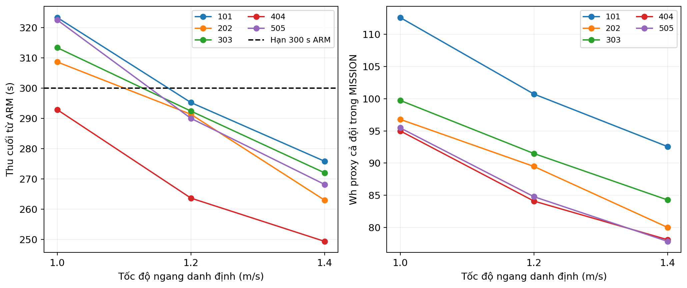
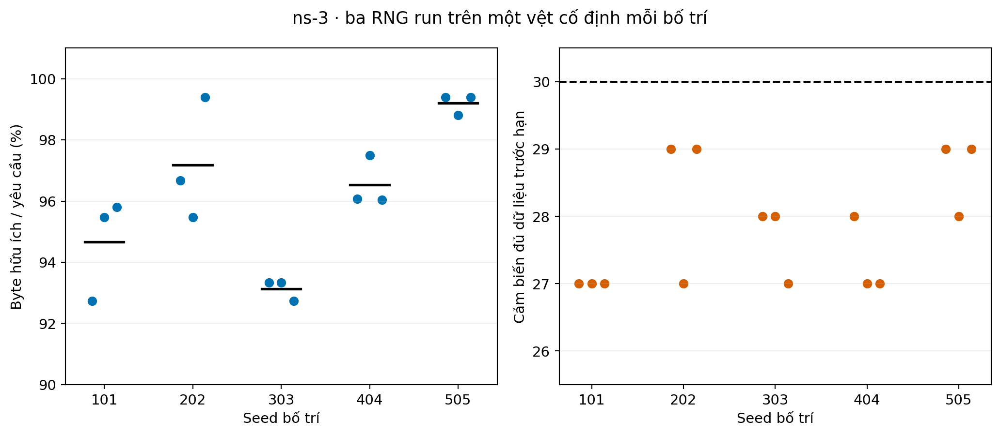
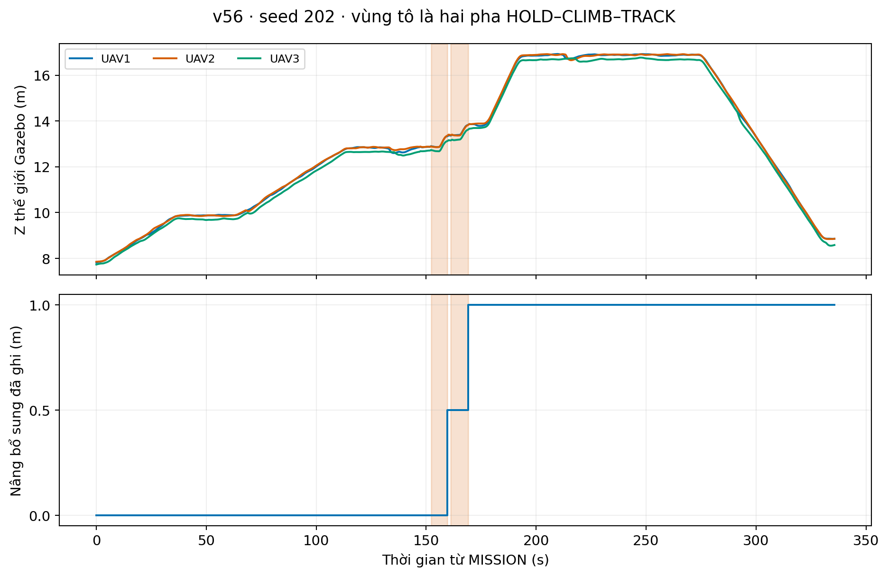

# Retained results and interpretation

These tables and figures were derived from **existing** project records, not generated by packaging this repository.

## Speed study: 5 layouts × 3 nominal speeds

| Nominal horizontal speed | Cases passing full historical checks | Sensors served by ARM deadline | Mean MISSION duration (s) | Mean team Wh proxy |
|---|---:|---:|---:|---:|
| 1.0 m/s | 1/5 | 133/150 | 379.077 | 99.910 |
| 1.2 m/s | 5/5 | 150/150 | 342.150 | 90.120 |
| 1.4 m/s | 5/5 | 150/150 | 313.802 | 82.576 |

Source: [speed_results.csv](../results/tables/speed_results.csv), 15 rows. Each configuration has one selected SITL run; this is not a repeated-flight uncertainty study. Five 1.2 m/s baseline runs were retained; ten 1.0/1.4 m/s runs were added in the historical speed experiment. Geometric service was complete even in the slower deadline failures. A controller DONE label is not the full set of mission criteria.

1.4 m/s was favorable within the tested feasible configurations; it is not a proven global optimum. Actual estimated instantaneous speed can exceed the nominal reference. The energy model includes MISSION waiting/return, excludes launch, landing and radio for this comparison, and is **uncalibrated**. PX4 battery SOC did not supply valid current to measure Wh. The level-flight power relationship follows Zeng et al., [arXiv:1804.02238](https://arxiv.org/abs/1804.02238); project extensions and assumed coefficients do not constitute X500 electrical calibration.

## Network replay: 5 fixed flights × 3 RNG runs

Source: [network_results.csv](../results/tables/network_results.csv), 15 rows, and [network_sensors.csv](../results/tables/network_sensors.csv), 450 sensor/run rows.

Total useful unique bytes: **43,264,000 / 45,000,000 (96.14%)**. Complete sensor/run records: **417/450**. Each run completed **27–29 of 30** sensors, not all 30. Received bytes arrived within the configured ARM deadline in this batch; missing bytes still remained. These repeated network RNG runs are not independent flight repeats.

Prepared inputs in `data/replay/` come from the retained executed Gazebo traces, not only the planned paths. Wi-Fi/propagation parameters are simulation assumptions: 802.11b 1 Mbps, shared channel, 0 dBm transmit power, log-distance exponent 2.2, 40.05 dB reference loss at 1 m, and 25 dB extra terrain-blocked loss. The ns-3 model has no hard 28 m radio cutoff. No application-layer retransmission or UAV relay protocol is added.

## Terrain and coordination evidence

The historical v56 integration case had two real UAV3 RISE events with hold/climb/release recovery and no service credit during recovery. The final v69 speed flights had **no reactive CLIMB events**; their terrain-related height changes were already in the planned route. The two test groups must not be conflated.

Shared progress reacts to a delayed/held member; this is centralized cooperation. It does not demonstrate distributed self-organization or modeled radio coordination between UAVs.

## Limits

- Synthetic fixed terrain, three UAVs and five development layouts.
- Two layouts use historical candidate-stop hints; ARM reserves were calibrated on development data.
- Geometry/sample checks are not continuous collision proofs for all disturbances.
- No calibrated battery power measurement, field radio calibration or physical flight result.
- No complete camera footprint coverage claim and no guarantee of receiving every sensor's payload.
- Packaging tests are reference/portability checks, not new scientific flight/network outcomes.

Raw ULogs, full historical records and the graduation report remain in the owner's separate handover archive. `archive://farm-sim/...` references identify those records; they are not downloadable URLs or runtime dependencies. Source SHA-256 values in the distributed tables and metadata identify the retained original files.
